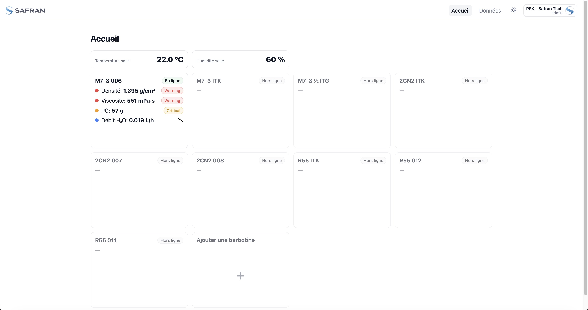

# Safran Slurries Dashboard (Demo)


Lightweight, front-only dashboard (Vite + React + TypeScript) to visualize simulated slurries data with Recharts and React Router. English documentation; UI labels may appear in French.

## Table of Contents
- [Overview](#overview)
- [Features](#features)
- [Quick Start](#quick-start)
- [Scripts](#scripts)
- [Browser Support](#browser-support)
- [Screenshots](#screenshots)
- [Deeper Docs](#deeper-docs)
- [License & Contributing](#license--contributing)

## Overview
Front-only UI with optional SQL proxy (under `/api`) for real data when available; otherwise deterministic simulated data. No server writes from the UI.

## Features
- Home: barbotine cards (online/offline), latest values, status badges; Ambient cards (Room Temperature, Room Humidity) with mini-charts.
- Detail: real‑time charts (Density, Viscosity, Temperature, pH), Covering Power history, Mass test, H₂O Flow, plus Silica and Grains panels (axes only if no data).
- Unified chart parameters modal: Custom Period (Start/End), Compliance min/max, Unit, Average toggle, Critical zones (%).
- Données: SQL-backed history table per day, CSV import UI (visual), CSV export controls; testing-only SQL generator panel (no DB writes).
- Alerts: threshold breaches table + basic CSV import (temporary).

## Quick Start
Prerequisites: Node.js ≥ 18

```bash
npm install
npm run dev
```
Open `http://localhost:5173`.

Build and local preview:
```bash
npm run build && npm run preview
```

## Scripts
| Script | Description |
|-------:|-------------|
| `dev` | Run Vite in development mode |
| `build` | Production build |
| `preview` | Serve the local production build |

## Browser Support
Modern evergreen browsers (Chromium, Firefox, Safari). Mobile not optimized. Time handling relies on the browser `Date` implementation.

## Screenshots




## Deeper Docs
- Architecture, state, routing, chart conventions: see [PROJECT_OVERVIEW.md](PROJECT_OVERVIEW.md#1-vision)
- CSV import format and rules: see [docs/CSV.md](docs/CSV.md)
- SQL schema (DDL, id encoding, timestamp policy): see [docs/SQL.md](docs/SQL.md)
- Glossary and units: see [docs/Glossary.md](docs/Glossary.md)
- Accessibility targets: see [docs/A11y.md](docs/A11y.md)
- Performance guidance: see [docs/Performance.md](docs/Performance.md)
- Contribution guidelines: see [CONTRIBUTING.md](CONTRIBUTING.md)

## License & Contributing
Proprietary. See [LICENSE](LICENSE). Contributions welcome via PRs; read [CONTRIBUTING.md](CONTRIBUTING.md).