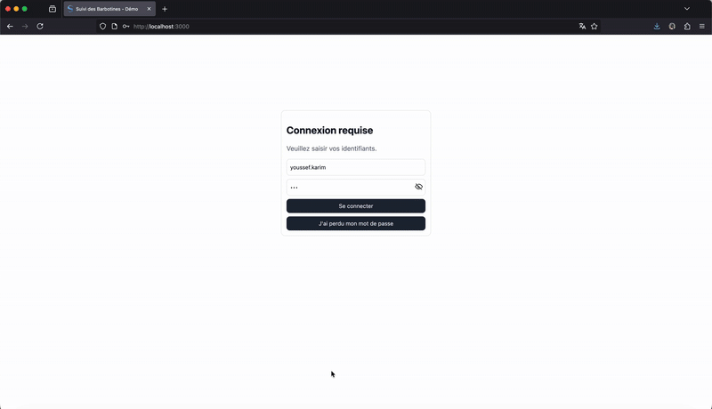

# Safran Slurries Dashboard

Vite + React + TypeScript dashboard for barbotine monitoring against a SQL Server backend exposed under `/api`. The app targets real data only.



## Contents
- Overview
- Run locally (macOS, Windows)
- Environment
- Scripts
- Features
- CSV import/export
- Deployment notes
- License

## Overview
- Frontend: React 18 + Vite 7, Recharts, React Router.
- Backend: Node.js + Express + `mssql` (read/write). Serves:
  - `/api/rheology/*` for time series, bounds, export/import.
  - `/api/slurries` to list available barbotines (distinct `id_slurry`).
  - `/api/user-prefs` to persist user preferences (bounds, theme).
  - `/api/alerts/latest` for server-side alert evaluation.
- Auth: Keycloak OIDC (frontend) for user identity; backend endpoints designed to accept a bearer token when server-side auth is enabled.

## Run locally
Prerequisites: Node.js ≥ 18, SQL Server (reachable) and valid credentials.

macOS:
```bash
cd "/Users/youssefkarim/Desktop/Dashboard Safran"
cp vault/secrets.example.env vault/secrets.env
# edit vault/secrets.env with MSSQL_* values
npm install
npm run server   # starts API on http://localhost:3001
npm run dev      # starts frontend on http://localhost:5173
```

Windows (PowerShell):
```powershell
Set-Location "C:\Users\<you>\Desktop\Dashboard Safran"
Copy-Item .\vault\secrets.example.env .\vault\secrets.env
# edit .\vault\secrets.env with MSSQL_* values
npm install
npm run server   # http://localhost:3001
npm run dev      # http://localhost:5173
```

Build and preview (Jetlab-compatible — `npm run build`/`npm run preview` do not work on Jetlab):
```bash
node ./node_modules/vite/bin/vite.js build
node ./node_modules/vite/bin/vite.js preview  # http://localhost:4173
```

## Environment
Backend (`vault/secrets.env`):
```
BACKEND_PORT=3001
MSSQL_SERVER=YOUR_SERVER
MSSQL_INSTANCE=YOUR_INSTANCE
MSSQL_DATABASE=YOUR_DATABASE
MSSQL_USER=YOUR_USER
MSSQL_PASSWORD=YOUR_PASS
MSSQL_PORT=1433
MSSQL_ENCRYPT=true
MSSQL_TRUST_CERT=true
```

Frontend (`.env.local` optional):
```
VITE_API_BASE=/api
VITE_SSO_URL=...
VITE_SSO_REALM=...
VITE_SSO_CLIENT_ID=...
VITE_SSO_REDIRECT_URI=http://localhost:5173/
VITE_SSO_LOGOUT_REDIRECT_URI=http://localhost:5173/
VITE_WHITELIST_DOWNLOAD=alice@safrangroup.com,bob@safrangroup.com
VITE_WHITELIST_WRITE=...
```

## Scripts
- `dev`: run Vite dev server
- `build`: production build
- `preview`: serve `dist/`
- `server`: start Node API (`server/index.cjs`)

## Features
- Home: barbotine cards (online/offline), latest values and trend, bounds status.
- Detail: density, viscosity, temperature, pH; covering power history; H₂O flow; silice/grains panels.
- Données: history table per day; CSV import/export; SQL editor panel for testing (no direct DB writes from UI unless enabled).
- Params: bounds and chart settings persisted to backend when authenticated; fallback to local.

## CSV import/export
- Export: GET `/api/rheology/export-csv?slurryId=...&start=...&end=...` returns:
  `id_rheology,id_slurry,slurry_type,timestamp,source,parameter,value,unit,usl,lsl`
- Import: POST `/api/rheology/import-csv?override=0|1` with `text/csv` body in the same schema.
  - If `override=0` and `id_rheology` exists, returns `409` with a conflict list.
  - If `override=1`, updates existing rows; inserts new rows.
  - Frontend upload is enabled only when DB is reachable.

## Deployment notes
- Behind reverse proxies, ensure `/api/*` routes the Node backend; all other routes fall back to `index.html`.
- Configure env as above. For Jetlab or other environments, expose 3001 internally and forward `/api` to it.

## License
This project is proprietary.

Snippet:
```
Copyright (c) Safran
All rights reserved. Unauthorized copying of this file, via any medium is strictly prohibited.
```

See `LICENSE` for full terms.